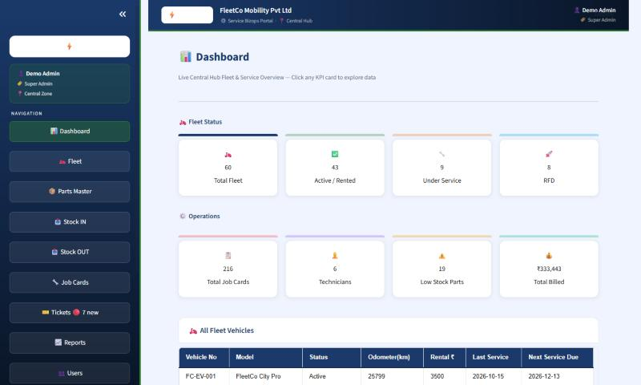
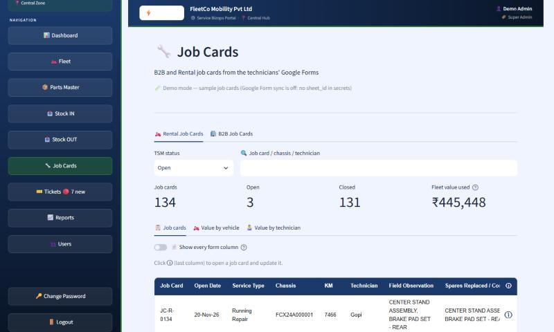
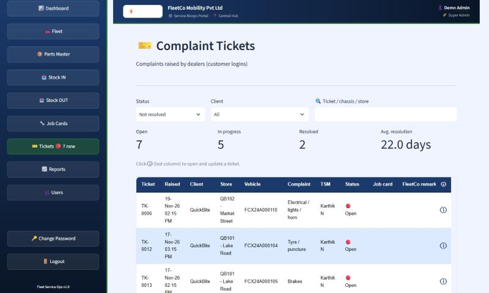
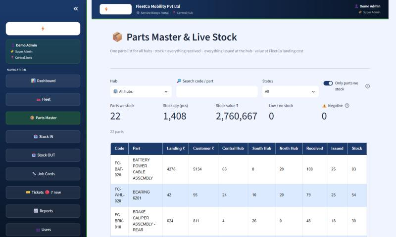
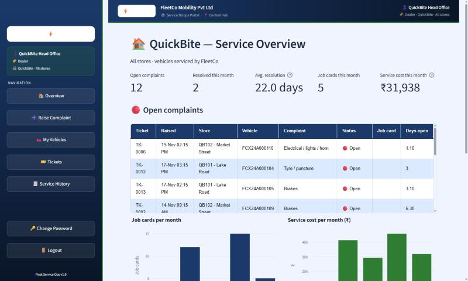
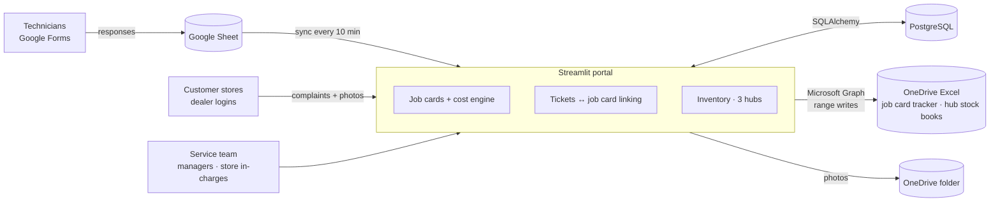

# ⚡ Fleet Service Ops Portal

A web portal that runs the **after-sales service operations of an electric-scooter fleet company**: job cards from field technicians, complaint tickets from B2B customers, spare-parts inventory across 3 warehouses, and live dashboards. It replaces a workflow spread over Google Forms, shared Excel files and WhatsApp.

**Python · Streamlit · PostgreSQL · SQLAlchemy · pandas · Plotly · Microsoft Graph API · Google Sheets**



> Built by me as a working internal tool at my previous employer and published here **with their written permission**. All company data, client names, people, IDs and credentials have been removed. Every name in this repository and in the screenshots (FleetCo, QuickBite, UrbanRide, the hubs and the people) is fictional, and the demo runs on generated sample data.

---

## The problem

The service team worked across several disconnected tools:

- Technicians filled in **Google Forms** for every repair. The answers landed in a sheet that managers copied by hand into an Excel "job card tracker" to add status, root cause and costs.
- **Costs were worked out manually** for every job card, from a separate price list of parts and labour.
- B2B customers (a food-delivery chain with many stores) **reported breakdowns by phone and WhatsApp**, with no record and no way to follow up.
- **Spare parts** were tracked in a separate Excel workbook for each warehouse. Nobody could see total stock, and parts sent between warehouses were entered twice.

## What the portal does

| Module | What it gives the team |
|---|---|
| **🔧 Job Cards** | Syncs technicians' Google Form answers every 10 minutes. Managers update status, observation and root cause, and **every save is written straight back into the team's OneDrive Excel tracker** (Microsoft Graph). Spares and labour costs are **calculated automatically** from the price list, at customer price for B2B and at landing cost for the company's own rental fleet. |
| **🎫 Dealer portal & tickets** | Each B2B customer store gets its own login. A store can only pick **its own vehicles** when raising a complaint (with an optional photo), then follow the ticket. The ticket links itself to the technician's job card (by ticket number or by chassis and date). Closing the job card resolves the ticket. Customers see their service history, costs and monthly charts. |
| **📦 Inventory (3 hubs)** | Live stock per warehouse with value, age of the oldest stock and low or negative stock alerts. **Stock IN, Stock OUT and hub-to-hub transfers** (one entry books both sides). An issue can't take more than the hub holds. Every entry is **appended as a new row in that hub's Excel**, with the sheet's own formulas copied down. Parts issued to a vehicle show on its job card. |
| **📊 Dashboard & reports** | Fleet status, job cards, low stock and billing, with clickable KPI cards and Excel export on every table. |
| **👥 Users & roles** | Role-based access (Admin, Service Head, Area Manager, Store In-charge, Territory Manager, Dealer). Territory managers see only their own clients. Includes temporary passwords, a forced change at first login, and a lockout after 5 wrong passwords. |

<table>
<tr><td></td><td></td></tr>
<tr><td align="center">Job cards (synced from Google Forms, costs auto-calculated)</td><td align="center">Complaint tickets from customer stores</td></tr>
<tr><td></td><td></td></tr>
<tr><td align="center">Live stock across 3 warehouses</td><td align="center">What a customer (dealer) login sees</td></tr>
</table>

## Architecture



## Engineering highlights

- **Excel stays in sync without being the database.** The team kept their Excel reports, but the portal became the place where data is entered. Updates are written over Microsoft Graph as **one range PATCH per row**, using a workbook session for batches, with retries when Excel Online is busy. A failed write is queued and retried. For sheets without Excel tables, a new row **copies the formulas of the row above and moves their row references** (`=VLOOKUP(C78,…)` becomes `=VLOOKUP(C79,…)`, while `$C$5` stays put).
- **Data isolation for customer logins.** A dealer's client and store come from the database at login, never from the page. Every dealer query goes through one scoping helper, and detail dialogs re-check the record id against that scope.
- **Safe stock issues.** Issues and transfers run in one transaction that locks the hub row (`SELECT … FOR UPDATE`), so two people can't both take the last piece.
- **Automatic linking.** Complaint tickets link to job cards by the form's "Ticket No" answer or by chassis and date window (`DISTINCT ON`, so one job card never serves two tickets). Stock issues link to the nearest job card for the same chassis.
- **Runs on free tiers.** Streamlit Community Cloud and a free Postgres (Supabase), with row-level security on and public API roles revoked. Photos are stored in OneDrive to keep the database small.

## Run it locally (demo mode)

You need Python 3.11+ and PostgreSQL. No Google or Microsoft account is needed: the integrations switch off automatically, and the portal runs on generated sample data.

```bash
git clone https://github.com/syril-023/fleet-service-ops-portal.git
cd fleet-service-ops-portal
pip install -r requirements.txt

createdb fleet_ops_db
psql -d fleet_ops_db -f db/schema.sql

cp .streamlit/secrets.toml.example .streamlit/secrets.toml   # then set your Postgres password
python db/seed_demo.py
streamlit run app.py
```

**Demo logins** (password `demo1234` for all):

| Username | Sees |
|---|---|
| `admin` | everything, including user management |
| `store.central` | Central hub store in-charge: enters that hub's stock |
| `tsm.south` | territory manager: own clients' job cards and tickets |
| `quickbite.hq` | customer head office: all its stores |
| `quickbite.qb101` | a single customer store |

## Project structure

```
app.py              Streamlit app: pages, roles, dealer portal, inventory screens
jobcards.py         Google Form sync, cost engine, Excel write-back (Microsoft Graph), ticket linking
inventory.py        Hub workbook import, stock levels, append-row Excel writes, job card linking
db_config.py        DB connection from Streamlit secrets or environment variables
db/schema.sql       Full PostgreSQL schema
db/seed_demo.py     Generates the fictional demo data
set_password.py     Admin helper for setting passwords from the command line
```

## My role

I designed and built the whole portal on my own as the business analyst on the service team. That covered gathering requirements from service managers and store in-charges, modelling the data, building the integrations with the existing Google Forms and Excel files, deploying it, and rolling it out module by module.

---

© 2026 Jacsun Maria Syril. All rights reserved. Shared for portfolio viewing only — not licensed for reuse.
